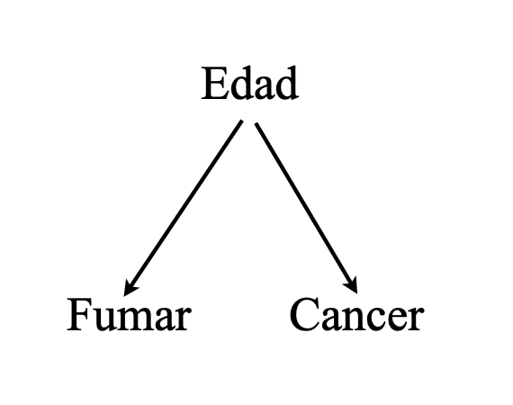

```{r course-style, include=FALSE}
library(pacman)
p_load(tidyverse, splines)
options(scipen = 999)

# Encuentra `_shared/bikeshare.R` sin depender del working directory.
source(local({
  d <- normalizePath(getwd(), mustWork = FALSE)
  cands <- d
  while (!identical(dirname(d), d)) { d <- dirname(d); cands <- c(cands, d) }
  cands <- c(cands, Sys.glob(file.path(getwd(), c("*", "*/*", "*/*/*"))))
  hits <- file.path(cands, "_shared", "bikeshare.R")
  hits <- hits[file.exists(hits)]
  if (!length(hits)) stop("No se encontró _shared/bikeshare.R desde ", getwd())
  normalizePath(hits[[1]])
}))
course_palette <- use_course_style("roma")
```

## Antes · Hoy · Después {.class-rhythm}

::: {.full-width}

::: {.content-box}
**Antes**

sobre-dispersión y quasi-Poisson.
:::

::: {.content-box-primary}
**Hoy**

asociación, contrafactuales y causalidad.
:::

::: {.content-box-secondary}
**Después**

predicción, overfitting y validación cruzada.
:::

:::

# Causalidad {.inverse .center .middle}

## Causas y efectos

<br>

Las ciencias, en un sentido amplio, están motivadas por preguntas *aparentemente* sencillas, del tipo:

<br>

  - ¿Cuán eficaz es un determinado tratamiento para prevenir una enfermedad?

  - ¿Las ventas aumentaron debido a la nueva ley o a la campaña publicitaria?

  - Al momento de contratar, ¿discriminan los empleadores en base al género de los/las postulantes?

  - etc.

<br>

. . .

Factor común: relaciones [causa-efecto]{.bold}.

## Mundos paralelos (I): la hipótesis causal

::: {.pull-left}

:::

::: {.pull-right}
<br>

[Hipótesis causal:]{.bold}

_"Fumar causa cáncer"_

<br>

[Pregunta contrafactual:]{.bold}

  - "Si fumo, ¿desarrollaré cáncer?" y

  - "Si no fumo, ¿evitaré el cáncer?"
:::

## Mundos paralelos (II): el resultado de Pedro

::: {.pull-left}

:::

::: {.pull-right}
<br>

|                |      Si Fumara               |     Si No Fumara              |
|----------------|:---------------------------:|:----------------------------:|
| Pedro        | Desarrolla cáncer           | Desarrolla cáncer       |
:::

## Mundos paralelos (III): el problema del multiverso

<br>

::: {.pull-left}

:::

::: {.pull-right}
Problema: no tenemos acceso al "multiverso"!


Ejemplo: "Pedro fuma"

|                |      si Fumara               |     si No Fumara              |
|----------------|:---------------------------:|:----------------------------:|
| Pedro          |  Desarrolla cáncer             |        |
:::

## El mundo observado (I): concomitancia de eventos

::: {.pull-left}

:::

::: {.pull-right}
<br>

Concomitancia de eventos:

|                | Fumador | Cáncer |
|----------------|:-----------:|:----------:|
| Pedro          | Sí          | Sí         |
| Juan           | No          | No         |
| Diego          | Sí          | Sí         |
| Fulano         | Sí          | No         |
| Menguano       | No          | No         |

- 2 de 3 fumadores desarrolla cancer
- 0 de 2 no fumadores desarrolla cancer
:::

## El mundo observado (II): otra forma de verlo

::: {.pull-left}

:::

::: {.pull-right}
<br>

Otra forma de verlo:

|                |      si Fumara         |     si No Fumara      |
|----------------|:--------------------------:|:--------------------------:|
| Pedro          | Desarrolla cáncer          |                           |
| Juan           |                            | No desarrolla cáncer       |
| Diego          | Desarrolla cáncer          |                           |
| Fulano         | No desarrolla cáncer       |                          |
| Menguano       |                            | No desarrolla cáncer       |
:::

## De Asociación a causalidad

::: {.pull-left}

:::

::: {.pull-right}
<br>

Para pasar de asociación a causalidad necesitariamos tener acceso a los mundos paralelos que no vemos:

|                |      si Fumara         |     si No Fumara      |
|----------------|:--------------------------:|:--------------------------:|
| Pedro          | Desarrolla cáncer          |     [(Desarrolla cáncer)]{.bold}                      |
| Juan           |  [(No desarrolla cáncer)]{.bold}                           | No desarrolla cáncer       |
| Diego          | Desarrolla cáncer          |    [(Desarrolla cáncer)]{.bold}                        |
| Fulano         | No desarrolla cáncer       |    [(No desarrolla cáncer)]{.bold}                      |
| Menguano       | [(No desarrolla cáncer)]{.bold}                           | No desarrolla cáncer       |
:::

## Asociación $\neq$ Causalidad

::: {.pull-left}
**Mundo observado:**

|                |      si Fumara         |     si No Fumara      |
|----------------|:--------------------------:|:--------------------------:|
| Pedro          | Desarrolla cáncer          |                         |
| Juan           |                             | No desarrolla cáncer       |
| Diego          | Desarrolla cáncer          |                          |
| Fulano         | No desarrolla cáncer       |                      |
| Menguano       |                          | No desarrolla cáncer       |

$$\mathbb{P}(\text{cancer} \mid \text{fumar} ) = 2/3 > \mathbb{P}(\text{cancer} \mid \text{no fumar}) = 0 $$
<br>

Conclusión #1: ["Fumar y desarrollar cancer están asociados estadísticamente"]{.bold}
:::

. . .

::: {.pull-right}
**Mundos paralelos:**

|                |      si Fumara         |     si No Fumara      |
|----------------|:--------------------------:|:--------------------------:|
| Pedro          | Desarrolla cáncer          |     [(Desarrolla cáncer)]{.bold}                      |
| Juan           |  [(No desarrolla cáncer)]{.bold}                           | No desarrolla cáncer       |
| Diego          | Desarrolla cáncer          |    [(Desarrolla cáncer)]{.bold}                        |
| Fulano         | No desarrolla cáncer       |    [(No desarrolla cáncer)]{.bold}                      |
| Menguano       | [(No desarrolla cáncer)]{.bold}                           | No desarrolla cáncer       |

$\mathbb{P}(\text{cancer} \mid \text{do(fumar)} ) =  \mathbb{P}(\text{cancer} \mid \text{do(no fumar)}) = 2/5$

<br>

Conclusión #2: ["Fumar no causa el desarrollo de cancer"]{.bold}
:::

## El $do(\cdot)$-operator de Judea Pearl

<br>

Todo lo que vimos con Pedro, Juan, Diego, Fulano y Menguano tiene nombre formal. El operador $do(\cdot)$ de Pearl describe qué pasaría si **interviniéramos** sobre $D$, en vez de solo observarlo. Para cada persona $i$:

<br>
$$
Y_i \mid do(D{=}1): \text{desarrolla cáncer o no, si fumara}
\qquad\qquad
Y_i \mid do(D{=}0): \text{desarrolla cáncer o no, si no fumara}
$$


. . .

<br>

El efecto causal individual es la diferencia entre ambas intervenciones: exactamente las columnas "si Fumara" / "si No Fumara" de las tablas de Pedro.

. . .

Como nunca observamos ambas intervenciones sobre la misma persona, apuntamos al efecto promedio del tratamiento:

$$
\text{ATE} = \mathbb{E}[Y\mid do(D{=}1)] - \mathbb{E}[Y\mid do(D{=}0)]
$$

<br>

. . .

Pero lo que los datos entregan es otra cosa: $\mathbb{E}[Y\mid D=1] - \mathbb{E}[Y\mid D=0]$, la asociación de Pedro y sus amigos. Condicionar ($\cdot  \mid D=1$) no es lo mismo que intervenir ($\cdot \mid do(D{=}1)$).


## El problema de fondo

La diferencia entre asociación y causalidad es fundamental y va más allá de los métodos estadísticos utilizados. Consideraciones clave:

<br>

- [NO es un problema de estimación]{.bold}: no se resuelve con técnicas estadísticas más complejas.

- [NO es un problema de incertidumbre estadística]{.bold}: no se soluciona con muestras más grandes.

- [ES un desafío inherente a la forma en que la realidad se manifiesta]{.bold}, y solo puede abordarse adecuadamente mediante un _diseño de investigación apropiado_, como:

  - Experimentos de laboratorio, experimentos naturales, estrategias de inferencia causal, entre otros.


# Estrategias de identificación {.inverse .center .middle}

## Dos caminos hacia el mismo objetivo

<br>

$\mathbb{E}[Y\mid do(D{=}d)]$ y $\mathbb{E}[Y\mid D{=}d]$ coinciden solo si $D$ no depende de nada más que de su propio azar.

<br>

. . .

Si algo más afecta $D$ -y ese algo también afecta $Y$-, condicionar en $D$ ya no equivale a intervenir sobre $D$.

<br>

. . .

Dos caminos para igualarlos:

1. [Diseñar $D$]{.bold}: que no dependa de nada. Aleatorización (RCT).

2. [Medir lo que afecta $D$]{.bold} y ajustar por ello. Backdoor criterion.

<br>

. . .

Para comparar ambos caminos con la misma vara, simulamos un mundo donde fijamos de antemano el efecto causal, $\tau$.

## El proceso generador de datos

```{r dgp-observacional, echo=TRUE}
set.seed(13)
n <- 2000
tau_verdadero <- log(2) # efecto causal de D sobre Y, en log-odds; lo fijamos nosotros

X <- sample(1:3, n, replace = TRUE, prob = c(0.3, 0.4, 0.3)) # edad: joven/media/vieja; la medimos

D <- rbinom(n, 1, plogis(-1.5 + 1.5 * (X - 2))) # X afecta a D
Y <- rbinom(n, 1, plogis(-3 + tau_verdadero * D + 1 * (X - 2))) # X también afecta a Y
```

Ahora $D$ y $Y$ tienen un mecanismo concreto: $X$ (edad) afecta a ambas. Por eso condicionar en $D$ no identifica el efecto de intervenir sobre $D$.

## Flechas que entran a $D$

::: {.pull-left}
Mundo observacional: $X$ es un backdoor path hacia $D$.

```{r dag-confound, echo=FALSE, fig.height=4.4}
dag_nodes <- tibble(
  x = c(1, 3, 2), y = c(1, 1, 2.45),
  label = c("D\nFuma", "Y\nCáncer", "X\nEdad")
)

draw_dag <- function(edges) {
  ggplot() +
    geom_segment(
      data = edges, aes(x, y, xend = xend, yend = yend),
      arrow = arrow(length = unit(0.22, "cm"), type = "closed"),
      color = course_palette[["secondary"]], linewidth = 1.1
    ) +
    geom_point(
      data = dag_nodes, aes(x, y), size = 30, shape = 21,
      fill = course_palette[["primary"]], color = "white"
    ) +
    geom_text(
      data = dag_nodes, aes(x, y, label = label),
      color = "white", size = 4.2, lineheight = 0.9
    ) +
    coord_cartesian(xlim = c(0.45, 3.55), ylim = c(0.55, 2.9)) +
    theme_void()
}

edges_confundido <- tibble(
  x = c(2, 2, 1), y = c(2.26, 2.26, 1),
  xend = c(1.12, 2.88, 2.82), yend = c(1.2, 1.2, 1)
)

draw_dag(edges_confundido)
```
:::

::: {.pull-right}
Mundo aleatorizado: se corta la flecha $X\to D$.

```{r dag-rct, echo=FALSE, fig.height=4.4}
edges_aleatorizado <- edges_confundido[2:3, ] # sin X -> D: aleatorizar corta esa flecha
draw_dag(edges_aleatorizado)
```
:::

## Por qué aleatorizar funciona

En general, $\mathbb{E}[Y\mid do(D{=}d)] \neq \mathbb{E}[Y\mid D{=}d]$: condicionar en $D$ arrastra también a $X$, a través de las flechas que entran a $D$.

. . .

Aleatorizar hace, físicamente, lo que el operador $do(\cdot)$ hace en el papel: corta toda flecha que entra a $D$. Sin flechas entrantes, ya no hay backdoor path que bloquear:

$$\mathbb{E}[Y\mid D{=}d] = \mathbb{E}[Y\mid do(D{=}d)]$$

. . .

La comparación simple entre grupos ya identifica el efecto causal, sin ajustar por nada.

## Un experimento aleatorizado

```{r rct-demo, echo=TRUE}
set.seed(13)

# 1. muestra: n personas, cada una con su edad
n <- 2000
X <- sample(1:3, n, replace = TRUE, prob = c(0.3, 0.4, 0.3))

# 2. asigna: se sortea D al azar, sin mirar X
D <- sample(rep(0:1, each = n / 2))

# 3. estima: se observa Y y se compara entre los dos grupos
Y <- rbinom(n, 1, plogis(-3 + tau_verdadero * D + 1 * (X - 2)))
logit_rct <- glm(Y ~ D, family = binomial)
coef(logit_rct)[["D"]]
```

$\hat\beta_D=`r sub("\\.", ",", formatC(coef(logit_rct)[["D"]], format = "f", digits = 3))`$, cerca de $\tau=`r sub("\\.", ",", formatC(tau_verdadero, format = "f", digits = 3))`$. Con 2.000 personas, y sin ajustar por $X$. Lo único que cambió frente al mundo observacional es la línea de $D$: en vez de depender de $X$, se sortea.

## ¿Fue suerte?

Repetimos el estudio aleatorizado 300 veces, cada vez con 600 personas nuevas, y lo comparamos con repetir el estudio observacional:

```{r rct-replicaciones, echo=TRUE}
n_rep <- 600
reps  <- 300

beta_crudo <- replicate(reps, {
  X <- sample(1:3, n_rep, replace = TRUE, prob = c(0.3, 0.4, 0.3)) # muestra
  D <- rbinom(n_rep, 1, plogis(-1.5 + 1.5 * (X - 2)))              # D depende de X
  Y <- rbinom(n_rep, 1, plogis(-3 + tau_verdadero * D + 1 * (X - 2)))
  coef(glm(Y ~ D, family = binomial))[["D"]]
})

beta_rct <- replicate(reps, {
  X <- sample(1:3, n_rep, replace = TRUE, prob = c(0.3, 0.4, 0.3)) # muestra
  D <- sample(rep(0:1, each = n_rep / 2))                          # asigna
  Y <- rbinom(n_rep, 1, plogis(-3 + tau_verdadero * D + 1 * (X - 2)))
  coef(glm(Y ~ D, family = binomial))[["D"]]                       # estima
})

dist_rct <- tibble(
  estrategia = rep(c("Crudo (observacional)", "Aleatorizado (RCT)"), each = reps),
  beta = c(beta_crudo, beta_rct)
)
```

## ¿Fue suerte? (II)

```{r rct-replicaciones-plot, echo=FALSE, fig.width=10, fig.height=5.5}
ggplot(dist_rct, aes(beta, fill = estrategia)) +
  geom_density(alpha = 0.7, color = "white") +
  geom_vline(xintercept = tau_verdadero, linetype = "dashed", linewidth = 0.9) +
  scale_fill_manual(values = unname(course_palette[c("series-1", "series-3")])) +
  labs(x = expression(hat(beta)[D] ~ "(300 réplicas)"), y = "densidad", fill = NULL)
```

La línea punteada es $\tau$. El diseño aleatorizado centra la distribución de $\hat\beta_D$ en $\tau$; el observacional no, por más réplicas que corramos.

## No siempre podemos aleatorizar

No podemos asignar aleatoriamente el tabaquismo a personas: sería inviable y profundamente antiético. Esta es la norma, no la excepción, en ciencias sociales y en salud pública.


## ¿Por qué pueden diferir? (I): asociación espuria

- Hay varias razones por las cuales puede pasar que asociación y causalidad no coincidan.

- Un caso paradigmático es cuando existe asociación espuria.

::: {.pull-left}

Edad actúa como un ["confounder"]{.bold}
:::

. . .

::: {.pull-right}
<br>

Mundos paralelos:

| Nombre   | Edad | si Fumara            | si No Fumara          |
|----------|:------:|:--------------------------:|:----------------------------:|
| Pedro    | Viejo   | Desarrolla cáncer        | [Desarrolla cáncer]{.bold}      |
| Juan     | Jóven   | [No desarrolla cáncer]{.bold} | No desarrolla cáncer       |
| Diego    | Viejo   | Desarrolla cáncer        | [Desarrolla cáncer]{.bold}      |
| Fulano   | Jóven   | No desarrolla cáncer     | [No desarrolla cáncer]{.bold}   |
| Menguano | Jóven   | [No desarrolla cáncer]{.bold} | No desarrolla cáncer       |
:::

## ¿Por qué pueden diferir? (II): el mundo observado con confusión

::: {.pull-left}

Edad actúa como un ["confounder"]{.bold}
:::

::: {.pull-right}
<br>

Mundos observados:

| Nombre   | Edad | Fumador | Cáncer |
|----------|------|:-----------:|:----------:|
| Pedro    | Viejo   | Sí          | Sí         |
| Juan     | Jóven   | No          | No         |
| Diego    | Viejo   | Sí          | Sí         |
| Fulano   | Joven   | No          | No         |
| Menguano | Joven   | No          | No         |
:::

## El backdoor criterion

::: {.pull-left}
$\mathbb{E}[Y\mid do(D{=}d)]$ no se lee directo de los datos: hay que decidir qué ajustar.

<br>

El **backdoor criterion**: $X$ alcanza si no es descendiente de $D$, y bloquea todo camino entre $D$ y $Y$ que entra a $D$ por una flecha.

<br>

. . .

Cuando lo cumple, promediar la asociación condicional dentro de cada valor de $X$, ponderando por cuán común es cada uno, identifica el efecto de intervenir:

$$
\mathbb{E}[Y\mid do(D{=}d)] = \sum_x \mathbb{E}[Y\mid D{=}d, X{=}x]\,\mathbb{P}(X{=}x)
$$
:::

::: {.pull-right}
```{r dag-backdoor, echo=FALSE, fig.height=4.6}
draw_dag(edges_confundido) +
  geom_point(
    data = dag_nodes[3, ], aes(x, y), size = 38, shape = 1,
    color = course_palette[["accent"]], stroke = 1.8
  )
```

Ajustar por $X$ bloquea el backdoor path $D \leftarrow X \to Y$.
:::

## El backdoor criterion en la simulación

$X$ es el único backdoor path hacia $D$ en nuestro mundo simulado. Ajustar por $X$ debería alcanzar:

```{r backdoor-demo, echo=TRUE}
n_rep <- 600
reps  <- 300

resultados <- replicate(reps, {
  X <- sample(1:3, n_rep, replace = TRUE, prob = c(0.3, 0.4, 0.3))
  D <- rbinom(n_rep, 1, plogis(-1.5 + 1.5 * (X - 2)))
  Y <- rbinom(n_rep, 1, plogis(-3 + tau_verdadero * D + 1 * (X - 2)))

  crudo    <- coef(glm(Y ~ D,     family = binomial))[["D"]]
  ajustado <- coef(glm(Y ~ D + X, family = binomial))[["D"]]
  c(crudo = crudo, ajustado = ajustado)
})

dist_backdoor <- tibble(
  estimador = rep(c("Crudo", "Ajustado por X"), each = reps),
  beta = c(resultados["crudo", ], resultados["ajustado", ])
)
```

## El backdoor criterion en la simulación (II)

```{r backdoor-demo-plot, echo=FALSE, fig.width=10, fig.height=5.5}
ggplot(dist_backdoor, aes(beta, fill = estimador)) +
  geom_density(alpha = 0.7, color = "white") +
  geom_vline(xintercept = tau_verdadero, linetype = "dashed", linewidth = 0.9) +
  scale_fill_manual(values = unname(course_palette[c("series-1", "series-2")])) +
  labs(x = expression(hat(beta)[D] ~ "(300 réplicas)"), y = "densidad", fill = NULL)
```

La línea punteada es $\tau$. Ajustar por $X$, el único backdoor path en este mundo, centra $\hat\beta_D$ en $\tau$. El crudo, no.

## El backdoor criterion no siempre alcanza

El criterio no es magia: hay que elegir bien qué ajustar. Dos formas típicas de fallar:

::: {.pull-left}
**Un confusor no observado**

```{r dag-no-observado, echo=FALSE, fig.height=4.2}
nodes_u <- tibble(
  x = c(1, 3, 2), y = c(1, 1, 2.45),
  label = c("D\nFuma", "Y\nCáncer", "U\n(oculto)")
)
edges_u_oculto <- tibble(x = c(2, 2), y = c(2.26, 2.26), xend = c(1.12, 2.88), yend = c(1.2, 1.2))
edge_dy <- tibble(x = 1.18, y = 1, xend = 2.82, yend = 1)

ggplot() +
  geom_segment(
    data = edges_u_oculto, aes(x, y, xend = xend, yend = yend),
    arrow = arrow(length = unit(0.22, "cm"), type = "closed"),
    color = course_palette[["secondary"]], linewidth = 1.1, linetype = "22"
  ) +
  geom_segment(
    data = edge_dy, aes(x, y, xend = xend, yend = yend),
    arrow = arrow(length = unit(0.22, "cm"), type = "closed"),
    color = course_palette[["secondary"]], linewidth = 1.1
  ) +
  geom_point(
    data = nodes_u, aes(x, y), size = 30, shape = 21,
    fill = course_palette[["primary"]], color = "white"
  ) +
  geom_text(
    data = nodes_u, aes(x, y, label = label),
    color = "white", size = 4.2, lineheight = 0.9
  ) +
  coord_cartesian(xlim = c(0.45, 3.55), ylim = c(0.55, 2.9)) +
  theme_void()
```

$U$ existe, pero no está en los datos: no hay forma de ajustar por él. El backdoor path queda abierto.
:::

::: {.pull-right}
**Ajustar por la variable equivocada**

```{r dag-collider, echo=FALSE, fig.height=4.2}
nodes_c <- tibble(
  x = c(1, 3, 2), y = c(1, 1, 2.45),
  label = c("D\nFuma", "Y\nCáncer", "C\nEspera")
)
edges_c <- tibble(
  x = c(1.12, 2.88, 1), y = c(1.2, 1.2, 1),
  xend = c(1.88, 2.12, 2.82), yend = c(2.2, 2.2, 1)
)

ggplot() +
  geom_segment(
    data = edges_c, aes(x, y, xend = xend, yend = yend),
    arrow = arrow(length = unit(0.22, "cm"), type = "closed"),
    color = course_palette[["secondary"]], linewidth = 1.1
  ) +
  geom_point(
    data = nodes_c, aes(x, y), size = 30, shape = 21,
    fill = course_palette[["primary"]], color = "white"
  ) +
  geom_point(
    data = nodes_c[3, ], aes(x, y), size = 38, shape = 1,
    color = course_palette[["secondary"]], stroke = 1.8
  ) +
  geom_text(
    data = nodes_c, aes(x, y, label = label),
    color = "white", size = 4.2, lineheight = 0.9
  ) +
  coord_cartesian(xlim = c(0.45, 3.55), ylim = c(0.55, 2.9)) +
  theme_void()
```

$C$ es un *collider*: efecto común de $D$ e $Y$, no su causa. Ajustar por él abre un camino espurio en vez de cerrarlo.
:::

## El mensaje de esta clase

<br>
<br>

::: {.content-box-primary}
**La causalidad no es un problema de inferencia. Es un problema de diseño: cómo se asignó $D$.**
:::


## Hasta la próxima clase. Gracias! {.inverse .center .middle .closing}

<br>
Mauricio Bucca <br>
https://mebucca.github.io/ <br>
github.com/mebucca
