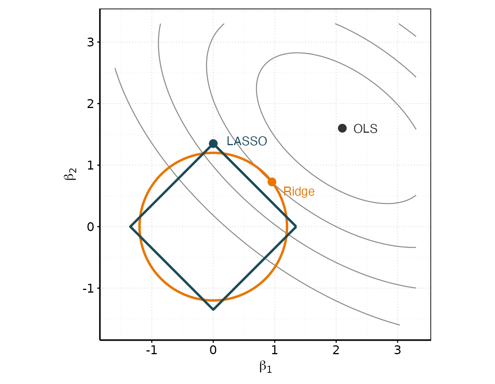

```{r setup, include=FALSE}
# `glmnet` ajusta Ridge, LASSO y Elastic Net; `tidyverse` organiza resultados.
library(pacman)
p_load(tidyverse)
p_load(glmnet)
# Este bloque solo resuelve rutas; no forma parte del análisis estadístico.
# Así la clase funciona aunque Quarto se ejecute desde otra carpeta.
source(local({
  d <- normalizePath(getwd(), mustWork = FALSE)
  cands <- d
  while (!identical(dirname(d), d)) { d <- dirname(d); cands <- c(cands, d) }
  cands <- c(cands, Sys.glob(file.path(getwd(), c("*", "*/*", "*/*/*"))))
  hits <- file.path(cands, "_shared", "bikeshare.R")
  hits <- hits[file.exists(hits)]
  if (!length(hits)) stop("No se encontró _shared/bikeshare.R desde ", getwd())
  normalizePath(hits[[1]])
}))
course <- use_course_data("valencia")
bikedata <- course$data %>% mutate(month = as.integer(mnth))
course_palette <- course$palette
```

## Antes · Hoy · Después {.class-rhythm}

::: {.full-width}

::: {.content-box}
**Antes**

cross-validation (clase 14) y el logit como clasificador, con umbrales y costos (clase 15).
Siempre con modelos donde *nosotros* elegimos la forma (variables, transformaciones e interacciones).
:::

::: {.content-box-primary}
**Hoy**

qué hacer cuando ya no confiamos en que esa forma sea la correcta.
:::

::: {.content-box-secondary}
**Después**

árboles, Random Forest y Gradient Boosting.
:::

:::

::: {.footnote}
Ridge, LASSO y Elastic Net **no descubren cualquier relación desde cero**:
regularizan una matriz $X$ cuya forma básica todavía especificamos nosotros.
:::

# Regularización {.inverse .center .middle}

## Qué cambia en este módulo

Durante todo el curso, cada modelo (LPM, logit, Poisson) compartió un mismo supuesto: **nosotros** elegimos qué variables entran, qué interacciones importan, qué transformaciones usar. El modelo solo estima los coeficientes.

. . .

Esta clase, junto con las clases 17 y 18, explora una pregunta distinta: **¿qué pasa cuando dejamos de confiar en que esa forma elegida a mano sea la correcta?** En esta clase, el procedimiento decide cuánta complejidad usar y qué coeficientes encoger; todavía no descubre todas las interacciones posibles.

| Método | ¿Qué decide automáticamente? |
|---|---|
| Ridge | cuánto encoger cada coeficiente |
| LASSO | cuánto encoger y cuáles llevar a cero |
| Árboles | particiones e interacciones de manera más flexible |

. . .

Referencia principal: James et al. (2021), *An Introduction to Statistical Learning* (ISLR), 2ª ed., **capítulo 6** ([sitio oficial](https://www.statlearning.com/)). Hoy seguimos ese capítulo en dos partes: primero los **conceptos**, después el **laboratorio** con datos de bicicletas y `glmnet` — exactamente como está organizado el libro.

# Parte 1 · Conceptos {.inverse .center .middle}

## La regla de evaluación antes de ver los datos

Antes de discutir Ridge o LASSO fijamos una regla que vale para todo el laboratorio:

| Nombre | Función | Pregunta |
|---|---|---|
| `train` | ajustar | ¿qué coeficientes aprende el modelo? |
| `valid` | elegir | ¿qué complejidad o hiperparámetro funciona mejor fuera de ajuste? |
| `test` | reportar | ¿cómo rinde la decisión ya congelada en datos nuevos? |

En la Parte 1 hablamos del **principio**. En la Parte 2 lo implementamos con bloques temporales concretos de `Bikeshare`: primero se define la partición y después se usa `valid` para seleccionar.

::: {.callout-warning}
`test` no es “otra validación”. Es el último chequeo y se consulta una sola vez, después de cerrar todas las decisiones.
:::

## La historia detrás del método

Estos métodos no nacieron en ciencias sociales ni con bicicletas — nacieron de dos problemas concretos:

- **Ridge (Hoerl & Kennard, 1970):** en química analítica, decenas de mediciones espectrales altamente correlacionadas entre sí producían coeficientes de mínimos cuadrados enormes e inestables, aunque el ajuste se viera perfecto. La solución: sumar una pequeña penalización para estabilizar la estimación.
- **LASSO (Tibshirani, 1996):** en genómica y otros campos con miles de predictores y pocos casos, Ridge estabilizaba pero no simplificaba — seguía usando todas las variables. Tibshirani buscó un método que, además de estabilizar, **eligiera** automáticamente cuáles variables importan.

. . .

El hilo común: ambos métodos nacen cuando los predictores son **muchos, correlacionados, o ambos**. En la Parte 2 vamos a ver el dataset real que usó el propio Tibshirani.

## Por qué no basta con mínimos cuadrados

ISLR da dos razones para buscar alternativas al logit/OLS sin penalizar:

- **Precisión predictiva:** si $p$ (número de predictores) se acerca a $n$ (observaciones), mínimos cuadrados tiene **varianza altísima**; si $p>n$, ni siquiera hay una solución única. Encoger los coeficientes reduce mucho la varianza a cambio de un poco de sesgo.
- **Interpretabilidad:** con muchas variables irrelevantes, el modelo es difícil de leer. Mínimos cuadrados casi nunca pone un coeficiente en **exactamente cero** — no elimina nada por sí solo.

{fig-align="center" width="42%"}

::: {.footnote}
Fuente: [GeeksforGeeks — Bias vs Variance in Machine Learning](https://www.geeksforgeeks.org/machine-learning/bias-vs-variance-in-machine-learning/)
:::

Ya vimos esta descomposición con polinomios en la clase 14: $E[(Y-\hat f)^2]=\text{sesgo}^2+\text{varianza}+\sigma^2$. Regularizar **aumenta** el sesgo a propósito para **reducir** la varianza.

## 6.1 — La alternativa obvia: elegir variables a mano

Si el problema es tener demasiados parámetros, lo más directo parece ser **probar subconjuntos de variables** y quedarnos con el mejor:

| Método | Cómo busca | Selección | Problema |
|---|---|---|---|
| Mejor subconjunto | prueba **todas** las combinaciones posibles | dura (0/1) | $2^p$ modelos — inviable con $p$ grande |
| Paso a paso (*stepwise*) | agrega o quita una variable a la vez | dura | *greedy*: puede quedar atrapado en un óptimo local |

{fig-align="center" width="38%"}

. . .

Con $p=20$ predictores, el mejor subconjunto ya exige evaluar $2^{20}\approx 1$ millón de modelos. Con interacciones (como hora × mes) $p$ puede pasar de 250. Stepwise es rápido, pero cada decisión de incluir o excluir una variable es **discreta**: un cambio mínimo en los datos puede alterar qué variables entran.

## 6.1.3 — ¿Cómo se elige el mejor subconjunto?

**Nunca** comparando RSS o $R^2$ en entrenamiento — siempre favorecen al modelo con más variables. ISLR ofrece dos caminos, ambos ya vistos en la clase 14:

| Camino | Qué hace | Visto en |
|---|---|---|
| $C_p$, AIC, BIC, $R^2$ ajustado | ajustan el error de entrenamiento con una penalización analítica por $k$ parámetros | clase 14 |
| Validación / validación cruzada | miden el error directamente en datos que el modelo no usó para ajustar | clase 14 |

Aquí “validación” todavía es el **principio general**. En el laboratorio definiremos explícitamente qué observaciones son `train`, cuáles son `valid` y cuál bloque queda sellado como `test`.

Ridge y LASSO reemplazan la búsqueda **discreta** de subconjuntos por una penalización **continua**: un solo problema de optimización convexo, no una búsqueda combinatoria. Para ver por qué, primero hay que nombrar el punto de partida.

## El punto de partida: estimación sin restricción

Todo el curso, hasta hoy, resolvimos:

$$
\widehat{\boldsymbol\beta}^{\text{MLE}}=\arg\min_{\boldsymbol\beta}\big\{-\ell(\boldsymbol\beta)\big\}.
$$

Sin restricción sobre $\boldsymbol\beta$: el óptimo es el que mejor ajusta estos datos, sin importar cuán grandes salgan los coeficientes. Esta es la estimación de **máxima verosimilitud** de siempre — GLM, logit, Poisson. Hoy le agregamos una restricción sobre el **tamaño** de $\boldsymbol\beta$.

## El marco general: penalizar con una norma

Para $q\ge 1$, la norma $L_q$ de un vector es $\|\boldsymbol\beta\|_q=\big(\sum_j|\beta_j|^q\big)^{1/q}$. En la práctica penalizamos $\|\boldsymbol\beta\|_q^q=\sum_j|\beta_j|^q$ — mismo mínimo, sin la raíz incómoda de derivar:

$$
\widehat{\boldsymbol\beta}_{\lambda,q}=\arg\min_{\boldsymbol\beta}\left\{-\ell(\boldsymbol\beta)+\lambda\sum_j|\beta_j|^q\right\}.
$$

- $\lambda=0$: para cualquier $q$, recupera exactamente $\widehat{\boldsymbol\beta}^{\text{MLE}}$ — la estimación sin restricción de la slide anterior.
- $q=2$: Ridge. $q=1$: LASSO. Ambas son normas verdaderas — ambas convexas.

. . .

¿Y "mejor subconjunto"? Penaliza $\#\{j:\beta_j\ne0\}$ — cuántos coeficientes son distintos de cero. A veces se le llama "norma" $L_0$, pero no cumple las propiedades de una norma (no es homogénea: duplicar $\boldsymbol\beta$ no duplica el conteo). Es exactamente lo que vimos antes, y explica por qué no es convexo: **contar no es una función suave**.

| Penalización | Convexa | Selecciona variables |
|---|---|---|
| $\#\{\beta_j\ne0\}$ — mejor subconjunto | no | sí — combinatoria |
| $L_1=\sum_j|\beta_j|$ — LASSO | sí | sí — continua |
| $L_2=\sum_j\beta_j^2$ — Ridge | sí | no |

LASSO es, en este sentido, un puente: la relajación convexa más cercana al conteo que todavía puede poner un coeficiente en exactamente 0.

## 6.2.1 — Ridge: la penalización $L_2$

$$
\widehat{\boldsymbol\beta}^{\text{ridge}}
=\arg\min_{\boldsymbol\beta}
\left\{\text{RSS (o }-\ell\text{)}+\lambda \underbrace{\sum_{j=1}^{p}\beta_j^2}_{P(\boldsymbol\beta)}\right\},
\qquad \lambda \ge 0.
$$

- $\lambda=0$: recupera el ajuste sin penalizar.
- $\lambda\to\infty$: todos los coeficientes (menos el intercepto) → 0.
- El intercepto **nunca se penaliza**: no representa el efecto de un predictor, sino el nivel base.

{fig-align="center" width="42%"}

::: {.footnote}
Fuente: [GeeksforGeeks — What is Ridge Regression](https://www.geeksforgeeks.org/machine-learning/what-is-ridge-regression/)
:::

Geométricamente: agregar una penalización por el tamaño de $\boldsymbol\beta$ es "tirar" al estimador hacia el origen, un poco menos lejos de donde los datos solos lo llevarían. Ridge **nunca** lleva un coeficiente a exactamente 0 — la región circular no tiene esquinas.

## Por qué Ridge estabiliza: predictores correlacionados

Si dos predictores (p. ej. `temp` y `atemp`, temperatura y sensación térmica) contienen casi la misma información, distintas combinaciones de coeficientes producen casi la misma predicción: $(\beta_1,\beta_2)=(1,0)$, $(0.5,0.5)$ o $(0,1)$ ajustan casi igual de bien. Sin penalizar, $X^\top X$ es casi no invertible y pequeños cambios en la muestra producen coeficientes muy distintos.

Ridge penaliza por **tamaño**, no solo por ajuste: entre soluciones casi empatadas, prefiere la de coeficientes más chicos y repartidos. Eso es lo que la estabiliza.

## 6.2.2 — LASSO: la penalización $L_1$

$$
\widehat{\boldsymbol\beta}^{\text{lasso}}
=\arg\min_{\boldsymbol\beta}
\left\{\text{RSS (o }-\ell\text{)}+\lambda \underbrace{\sum_{j=1}^{p}|\beta_j|}_{P(\boldsymbol\beta)}\right\}.
$$

Misma estructura que Ridge — mismo rol de $\lambda$ — la única diferencia es la **forma** de la penalización: suma de cuadrados vs. suma de valores absolutos. Eso basta para cambiar por completo el comportamiento del estimador.

## Por qué LASSO selecciona y Ridge no

{fig-align="center" width="58%"}

Círculo = restricción Ridge ($\sum\beta_j^2\le s$); diamante = restricción LASSO ($\sum|\beta_j|\le s$). El estimador penalizado es donde las curvas de nivel de la pérdida (elipses) **tocan primero** la región de restricción.

- El diamante tiene **vértices sobre los ejes** — es fácil tocar justo ahí, y en un vértice algún $\beta_j=0$.
- El círculo no tiene esquinas: contrae, pero casi nunca anula.

## La mecánica: soft-thresholding

Con predictores ortonormales, la solución LASSO es explícita y deja ver el mecanismo exacto:

$$
\widehat\beta_j^{\text{lasso}}
=\operatorname{sign}\!\big(\widehat\beta_j^{\text{OLS}}\big)\,
\big(|\widehat\beta_j^{\text{OLS}}|-\lambda\big)_+ .
$$

Ridge, en cambio, solo **escala**: $\widehat\beta_j^{\text{ridge}}=\widehat\beta_j^{\text{OLS}}/(1+\lambda)$ — nunca llega a 0 exacto.

| | Ridge | LASSO |
|---|---:|---:|
| Si $\widehat\beta^{\text{OLS}}=0.6$, $\lambda=1$ | $0.30$ | $0$ |
| Si $\widehat\beta^{\text{OLS}}=2.0$, $\lambda=1$ | $1.00$ | $1.00$ |

$(\cdot)_+$ = parte positiva: si $|\widehat\beta_j^{\text{OLS}}|<\lambda$, LASSO manda el coeficiente a **exactamente 0**. Ridge solo lo encoge.

## Elastic Net: lo mejor de ambos

LASSO selecciona, pero con predictores muy correlacionados tiende a **elegir uno arbitrariamente y descartar el resto**. Elastic Net combina ambas penalizaciones:

$$
P_{\alpha}(\boldsymbol\beta)=
(1-\alpha)\sum_j\beta_j^2+
\alpha\sum_j|\beta_j|.
$$

| $\alpha$ | Modelo | Comportamiento típico |
|---:|---|---|
| 0 | Ridge | conserva todos los predictores |
| 1 | LASSO | produce soluciones dispersas |
| entre 0 y 1 | Elastic Net | combina estabilidad y selección |

El término $L_2$ reparte el peso entre variables correlacionadas (**efecto de agrupamiento**); el término $L_1$ conserva la capacidad de anular bloques irrelevantes.

## Ridge vs. LASSO: ¿cuál conviene?

ISLR es explícito: **ninguno domina siempre**. Depende de la estructura real de los coeficientes:

| Situación | Gana |
|---|---|
| Muchos predictores con efectos moderados, ninguno domina | **Ridge** |
| Pocos predictores con efecto fuerte, el resto irrelevante | **LASSO** |
| No sabemos cuál escenario es cierto | **validación decide**, no una preferencia a priori |

. . .

Interpretación bayesiana (opcional): Ridge equivale a un *prior* gaussiano sobre $\boldsymbol\beta$; LASSO equivale a un *prior* doble-exponencial (Laplace), que concentra más masa en 0. Mismo problema, dos supuestos distintos sobre dónde "esperamos" encontrar los coeficientes antes de ver los datos.

## 6.2.3 — Elegir $\lambda$ (y $\alpha$)

$\lambda$ no se estima maximizando la verosimilitud — si lo hiciéramos, siempre ganaría $\lambda=0$ (cero penalización, máximo ajuste, el problema del comienzo). Es un hiperparámetro, y se elige **igual que el grado del polinomio (clase 14) o el umbral $\tau$ (clase 15)**: con una curva de validación o $k$-fold CV, minimizando el error fuera de muestra.

{fig-align="center" width="52%"}

::: {.footnote}
Fuente: [GeeksforGeeks — What is Ridge Regression](https://www.geeksforgeeks.org/machine-learning/what-is-ridge-regression/)
:::

$\lambda=0$: sesgo bajo, varianza alta. $\lambda\to\infty$: sesgo alto, varianza baja (subajuste). Existe un $\lambda^{*}$ intermedio que minimiza el error — no lo conocemos, lo **estimamos con validación**. Con Elastic Net, $\alpha$ se elige igual: una grilla más, evaluada con la misma validación.

## Alta dimensión: cuando $p$ se acerca a $n$ (o lo supera)

Esto conecta con la historia del comienzo (genómica: miles de genes, pocos pacientes):

- Si $p>n$, mínimos cuadrados **no tiene solución única** — ni siquiera se puede calcular.
- LASSO sí puede ajustarse, pero selecciona **a lo sumo $n$ variables**, aunque más sean relevantes.
- $R^2$ y los $p$-valores clásicos de un GLM sin penalizar **dejan de ser confiables** en alta dimensión: un modelo con $p\approx n$ puede ajustar perfecto el entrenamiento y no servir para nada fuera de muestra.

La regularización no es un lujo en este escenario — es la única forma de obtener un modelo.

## Síntesis de la Parte 1

| | Ridge | LASSO | Elastic Net |
|---|---|---|---|
| Penalización | $L_2$ | $L_1$ | $L_1+L_2$ |
| Coeficientes | todos se achican, ninguno en 0 | algunos exactamente 0 | algunos en 0, resto achicado |
| Resuelve | colinealidad / inestabilidad | selección de variables | ambos, con bloques correlacionados |
| Hiperparámetros | $\lambda$ | $\lambda$ | $\lambda$ y $\alpha$ |
| Elección de $\lambda$ (y $\alpha$) | validación / CV — nunca maximizando el ajuste en entrenamiento | | |

. . .

Todo lo anterior es **conceptual** — no hemos tocado una sola fila de datos. Ahora sí: bicicletas, `glmnet`, y cada línea de código en detalle.

# Parte 2 · Laboratorio: bicicletas con `glmnet` {.inverse .center .middle}

```{r setup-continued, include=FALSE}

# Diseño y partición compartidos (ver _shared/bikeshare.R).
setup <- bikeshare_learning_setup(bikedata)
# Esta función compartida define el outcome, aprende el corte en train,
# construye X y crea la partición cronológica. Aquí solo reutilizamos sus objetos.
bikedata <- setup$data
days <- setup$days
train_days <- setup$train_days
valid_days <- setup$valid_days
test_days <- setup$test_days
id_train <- setup$id_train
id_valid <- setup$id_valid
id_test <- setup$id_test
demand_cutoff <- setup$demand_cutoff
high_demand <- setup$high_demand

x_all <- setup$x_all
x_train <- x_all[id_train, , drop = FALSE]
x_valid <- x_all[id_valid, , drop = FALSE]
x_test <- x_all[id_test, , drop = FALSE]
y_train <- high_demand[id_train]
y_valid <- high_demand[id_valid]
y_test <- high_demand[id_test]

# Costos de decisión: se pueden cambiar en el ejercicio sin tocar el modelo.
false_negative_cost <- 3
false_positive_cost <- 1

log_loss <- function(y, p) {
  p <- pmin(pmax(p, 1e-8), 1 - 1e-8)
  -mean(y * log(p) + (1 - y) * log(1 - p))
}

class_metrics <- function(y, p, threshold = 0.5,
                          false_negative_cost = 3,
                          false_positive_cost = 1) {
  predicted <- as.integer(p >= threshold)
  tp <- sum(predicted == 1 & y == 1)
  tn <- sum(predicted == 0 & y == 0)
  fp <- sum(predicted == 1 & y == 0)
  fn <- sum(predicted == 0 & y == 1)
  safe_ratio <- function(num, den) ifelse(den == 0, NA_real_, num / den)
  tibble(
    log_loss = log_loss(y, p),
    accuracy = mean(predicted == y),
    sensitivity = safe_ratio(tp, tp + fn),
    specificity = safe_ratio(tn, tn + fp),
    precision = safe_ratio(tp, tp + fp),
    cost_per_100 = 100 * (false_negative_cost * fn + false_positive_cost * fp) / length(y)
  )
}
```

## Antes de ajustar: el contrato de tres conjuntos

Desde este punto usaremos siempre los mismos nombres:

| Conjunto | Qué contiene | Qué está permitido hacer |
|---|---|---|
| **Training / `train`** | pasado temprano | ajustar coeficientes, estandarizar y aprender el corte de demanda |
| **Validation / `valid`** | periodo siguiente | elegir complejidad, $\alpha$, $\lambda$ y umbral operativo |
| **Testing / `test`** | periodo final, reservado | reportar desempeño final una sola vez |

La regla es:

$$
\underbrace{\text{ajustar en train}}_{\text{aprender}}\;\longrightarrow\;
\underbrace{\text{comparar en valid}}_{\text{elegir}}\;\longrightarrow\;
\underbrace{\text{reajustar train+valid}}_{\text{congelar la decisión}}\;\longrightarrow\;
\underbrace{\text{evaluar en test}}_{\text{reportar}}
$$

**El `test` no participa en ninguna elección.** Si miramos su desempeño para cambiar
$\alpha$, $\lambda$, variables o umbral, deja de ser un test y pasa a ser otra validación.

::: {.callout-note}
En la clase, “validación” significará por defecto este **bloque temporal `valid`**. Más adelante mostraremos `cv.glmnet()` como una alternativa de validación cruzada interna, no como un cuarto conjunto.
:::

## La solicitud predictiva

> **Al cierre de cada día, estimar qué horas del día siguiente tendrán demanda alta, para priorizar el rebalanceo de bicicletas.**

| Elemento | Definición |
|---|---|
| Unidad y horizonte | una hora, hasta 24 horas |
| Target | sobre el percentil 75 aprendido en train |
| Información | calendario, hora y pronóstico meteorológico |
| Costo | falso negativo = 3; falso positivo = 1 |
| Evaluación | partición temporal 60/20/20 |

**Dos cortes distintos:** el percentil 75 transforma demanda observada en $Y\in\{0,1\}$;
el umbral de probabilidad transforma $\hat p$ en una acción. El primero se aprende
en `train`; el segundo se elegirá después usando costos en `valid`, como en la clase 15.

## El problema, con datos reales

Démosle al logit una interacción **completa** entre hora (24 categorías) y mes (12 categorías): mucho más flexible que la interacción hora × día hábil que usamos hasta ahora. Agreguemos esas variables de a poco y observemos qué pasa.

Aquí aparece por primera vez el uso operativo de la partición: cada modelo se **ajusta solamente en `train`** y se mide en **`valid`**. El conjunto **`test` permanece cerrado** y no se toca en esta curva.

```{r overfit-demo, echo=FALSE, fig.height=5}
features_base <- ~ temp + atemp + I(temp^2) + hum + I(hum^2) + windspeed +
  holiday + factor(weathersit) + factor(hr) + factor(month)
x_base <- model.matrix(features_base, bikedata)[, -1]
x_hour_month <- model.matrix(~ factor(hr):factor(month), bikedata)[, -1]
x_hour_month <- x_hour_month[, apply(x_hour_month[id_train, , drop = FALSE], 2, sd) > 0,
                             drop = FALSE]
x_flex <- cbind(x_base, x_hour_month)
x_flex_train <- x_flex[id_train, , drop = FALSE]
x_flex_valid <- x_flex[id_valid, , drop = FALSE]

# k agrega columnas de la interacción a una base fija; no es una selección real,
# sino un experimento didáctico para hacer visible el costo de la flexibilidad.
k_grid <- unique(pmin(c(0, 6, 12, 18, 24, 36, 48, 72, 96), ncol(x_hour_month)))

complejidad <- map_dfr(k_grid, function(k) {
  interaction_cols <- if (k == 0) integer() else seq_len(min(k, ncol(x_hour_month)))
  keep_cols <- c(seq_len(ncol(x_base)), ncol(x_base) + interaction_cols)
  Xk_train <- cbind(`(Intercept)` = 1, x_flex_train[, keep_cols, drop = FALSE])
  Xk_valid <- cbind(`(Intercept)` = 1, x_flex_valid[, keep_cols, drop = FALSE])
  ajuste <- glm.fit(x = Xk_train, y = y_train, family = binomial())
  beta <- replace_na(coef(ajuste), 0)
  p_train <- plogis(as.numeric(Xk_train %*% beta))
  p_valid <- plogis(as.numeric(Xk_valid %*% beta))
  tibble(
    parametros = ncol(Xk_train),
    interacciones_agregadas = k,
    train_log_loss = log_loss(y_train, p_train),
    valid_log_loss = log_loss(y_valid, p_valid)
  )
})

complejidad %>%
  pivot_longer(c(train_log_loss, valid_log_loss), names_to = "conjunto", values_to = "log_loss") %>%
  ggplot(aes(parametros, log_loss, color = conjunto)) +
  geom_line(linewidth = 1.2) +
  geom_point(size = 2.6) +
  scale_color_course() +
  geom_point(data = complejidad %>% slice_min(valid_log_loss, n = 1),
             aes(parametros, valid_log_loss), color = course_palette[["primary"]], size = 4,
             inherit.aes = FALSE) +
  labs(x = "Número de parámetros en el modelo", y = "Log-loss (menor = mejor)", color = NULL)
```

La interacción completa no genera $24\times12=288$ columnas porque `model.matrix`
usa una categoría de referencia: genera $(24-1)(12-1)=253$ columnas de interacción.
Aquí $k$ solo controla cuántas de esas columnas agregamos.

## Leer la curva

- Con pocos parámetros, **ambos** errores bajan juntos: el modelo aprende señal real (temperatura, hora, clima).
- Pasado cierto punto, el error de **`train`** sigue bajando, pero el de **`valid`** empieza a **subir**: el modelo empieza a ajustar celdas hora×mes con pocas observaciones, memorizando ruido específico de esa combinación.
- **No sabíamos de antemano** cuál de estas 253 variables era señal y cuál era ruido — todas entraron con la misma justificación teórica ("la demanda varía por hora y por estación").

La decisión concreta en esta curva es: **qué nivel de complejidad sobrevive en `valid`**. Todavía no estamos reportando desempeño final; eso ocurrirá recién cuando el modelo y sus hiperparámetros estén congelados y usemos `test` una sola vez.

Exactamente el problema de la Parte 1: demasiados parámetros, elegidos a mano. Veamos si Ridge y LASSO lo resuelven.

## Configuración: outcome y partición

El módulo completo (clases 15–18) comparte la misma preparación de datos.

```{r config-split, eval=FALSE}
# Preparación compartida por las clases 15-18 (ver _shared/bikeshare.R)
setup <- bikeshare_learning_setup(bikedata)

# Outcome binario: "alta demanda" = top 25% de las horas.
# El umbral (cuantil 0.75) se aprende SOLO en entrenamiento.
demand_cutoff <- setup$demand_cutoff
high_demand   <- setup$high_demand

# Partición CRONOLÓGICA 60/20/20 por día (no aleatoria):
# entrenar con el pasado, validar después, reservar los últimos días para test.
id_train <- setup$id_train
id_valid <- setup$id_valid
id_test  <- setup$id_test
```

## Configuración: la matriz de diseño

Sobre esos datos construimos la matriz de predictores $X$ que usarán Ridge, LASSO y Elastic Net:

```{r config-design, eval=FALSE}
features <- setup$features
x_all   <- setup$x_all
x_train <- x_all[id_train, ]; y_train <- high_demand[id_train]
x_valid <- x_all[id_valid, ]; y_valid <- high_demand[id_valid]
x_test  <- x_all[id_test, ];  y_test  <- high_demand[id_test]
```

$$
X=\texttt{setup\$x\_all}
=\texttt{model.matrix(setup\$features,\ bikedata)[,-1]}.
$$

```{r}
tibble(
  observaciones_train = nrow(x_train),
  términos_formula = 12,
  columnas_modelo = ncol(x_train)
)
```

`temp` y `atemp` son deliberadamente casi idénticas: ese es precisamente el tipo de colinealidad donde Ridge resulta más útil. `I(temp^2)` le dice a R que eleve la variable al cuadrado; `[, -1]` elimina el intercepto porque `glmnet` lo estima por separado y no lo penaliza.

| Término | Qué agrega | Columnas típicas |
|---|---|---:|
| `temp`, `atemp` | efectos lineales | 2 |
| `I(temp^2)`, `I(hum^2)` | curvatura | 2 |
| `factor(weathersit)` | indicadores con referencia | varias |
| `factor(hr)` | una columna por hora menos una referencia | 23 |
| `factor(hr) * workingday` | interacción hora × día hábil | 23 |
| seno/coseno del mes | estacionalidad circular | 2 |

## Ampliando la matriz: metemos el problema que ya vimos

Con esta matriz el logit sin penalizar no sobreajusta demasiado — el contraste con Ridge/LASSO se notaría poco. Agreguemos exactamente el problema de la sección "El problema, con datos reales": la interacción completa hora × mes. `x_hour_month` ya está calculada — no la recalculamos.

```{r augment-design}
cols_antes <- ncol(x_train)

x_train <- cbind(x_train, x_hour_month[id_train, , drop = FALSE])
x_valid <- cbind(x_valid, x_hour_month[id_valid, , drop = FALSE])
x_test  <- cbind(x_test,  x_hour_month[id_test, , drop = FALSE])

tibble(
  columnas_antes = cols_antes,
  columnas_hora_mes_agregadas = ncol(x_hour_month),
  columnas_después = ncol(x_train)
)
```

De aquí en adelante, Ridge, LASSO y Elastic Net compiten contra exactamente esa matriz difícil — la misma que, sin penalizar, hizo subir el log-loss de validación en la curva de sobreajuste.

## Qué hacemos —y qué no hacemos— en cada conjunto

```{r}
tibble(
  conjunto = c("Entrenamiento", "Validación", "Test"),
  proporción = c("60%", "20%", "20%"),
  función = c("estimar coeficientes y escalas", "elegir $\\alpha$, $\\lambda$ y umbral", "estimar desempeño final, una sola vez"),
  primer_día = c(min(train_days), min(valid_days), min(test_days)),
  último_día = c(max(train_days), max(valid_days), max(test_days))
)
```

Este cuadro es el protocolo de toda la clase. Mirar `test` durante el *tuning* produce **filtración de información**. Ajustamos con el pasado, elegimos hiperparámetros y umbral en `valid`, y reservamos los últimos días para `test`: una partición aleatoria sería optimista si horas vecinas comparten patrones no observados.

# Ridge en `glmnet` {.inverse .center .middle}

## `glmnet`: una función, tres penalizaciones

```{r glmnet-signature, eval=FALSE}
glmnet(x, y, family = "binomial", alpha = ..., lambda = ..., standardize = TRUE)
```

| Argumento | Qué controla |
|---|---|
| `alpha` | `0` = Ridge, `1` = LASSO, entre 0 y 1 = Elastic Net |
| `lambda` | un valor o una secuencia — si se omite, `glmnet` calcula su propia ruta |
| `standardize` | estandariza $X$ antes de penalizar (por defecto `TRUE`, usando solo train) |
| `family` | `"binomial"` aquí, porque el outcome es 0/1 |

`glmnet` estandariza con media y desviación de **entrenamiento únicamente** — nunca de validación o test. La penalización opera sobre el tamaño *numérico* del coeficiente: sin estandarizar, castigaría por unidades (metros vs. kilómetros), no por importancia real.

## Ajustando Ridge: la ruta completa de $\lambda$

```{r ridge-path, fig.height=5}
lambda_path <- exp(seq(log(100), log(0.001), length.out = 70))
ridge_fit <- glmnet(
  x_train, y_train, family = "binomial", alpha = 0,
  lambda = lambda_path, standardize = TRUE
)

# Coeficientes en escala estandarizada (coef × sd de cada predictor): así son
# comparables entre variables de magnitudes muy distintas (p. ej. `temp` vs.
# un indicador 0/1), y el contraste Ridge/LASSO se ve con claridad.
sds <- apply(x_train, 2, sd)
ridge_coef <- as.matrix(coef(ridge_fit))[-1, , drop = FALSE] * sds
ridge_long <- as_tibble(t(ridge_coef), .name_repair = "minimal") %>%
  mutate(lambda = ridge_fit$lambda) %>%
  pivot_longer(-lambda, names_to = "variable", values_to = "coefficient")

compare_vars <- c("cos(2 * pi * month/12)", "factor(hr)14",
                   "workingday", "factor(weathersit)light rain/snow")

ridge_long %>%
  filter(variable %in% compare_vars) %>%
  ggplot(aes(log(lambda), coefficient, color = variable)) +
  geom_hline(yintercept = 0, color = "grey50", linewidth = 0.7) +
  geom_line(linewidth = 1.15) +
  scale_color_course() +
  labs(x = expression(log(lambda)), y = "Coeficiente (estandarizado)", color = NULL)
```

`alpha = 0` le dice a `glmnet` que use $L_2$ pura. `lambda_path` va de 100 (mucha penalización) a 0.001 (casi nada) — por eso `glmnet` recorre $\lambda$ de mayor a menor internamente. Nótese que **ninguna** curva toca exactamente 0: se acercan, pero Ridge nunca las anula del todo.

## Interpretación: leer la trayectoria

- Como el eje muestra `log(lambda)` y la secuencia va de mayor a menor, hacia la **izquierda** aumenta $\lambda$; todos los coeficientes se contraen **suavemente**, sin saltos.
- Ninguna variable desaparece de forma abrupta — Ridge nunca las anula.
- Esta trayectoria muestra **cómo cambia el modelo** con $\lambda$; todavía no nos dice cuál $\lambda$ predice mejor — eso lo resolvemos con validación, más adelante.

## Cápsula opcional: qué hace Ridge, dirección por dirección

**No necesitas esto para usar Ridge** — es para quienes quieran ver *por qué* funciona. Con la descomposición $X=UDV^\top$ (columnas estandarizadas), las predicciones Ridge se contraen **dirección por dirección**:

$$
\widehat y=\sum_{j}u_j\,\frac{d_j^{2}}{d_j^{2}+\lambda}\,u_j^\top y.
$$

```{r svd-shrinkage, echo=FALSE, fig.height=4.2}
keep <- apply(x_train, 2, sd) > 0
xs <- scale(x_train[, keep, drop = FALSE]) / sqrt(nrow(x_train))
d_sv <- svd(xs)$d

shrink <- map_dfr(c(0.001, 0.01, 0.1, 1), function(l) {
  tibble(lambda = l, componente = seq_along(d_sv),
         factor = d_sv^2 / (d_sv^2 + l))
})

shrink %>%
  mutate(lambda = factor(lambda)) %>%
  ggplot(aes(componente, factor, color = lambda)) +
  geom_line(linewidth = 1.1) +
  scale_color_course() +
  scale_y_continuous(limits = c(0, 1)) +
  labs(x = "Componente (de mayor a menor varianza)",
       y = expression(d[j]^2 / (d[j]^2 + lambda)),
       color = expression(lambda))
```

Direcciones de **poca varianza** (colineales, como `temp`$\approx$`atemp`) se contraen **más** — son justo las que producen coeficientes inestables. Ridge no las elimina; les quita influencia.

# LASSO y Elastic Net en `glmnet` {.inverse .center .middle}

## Ajustando LASSO: `alpha = 1`

```{r lasso-path, fig.height=5}
lasso_fit <- glmnet(
  x_train, y_train, family = "binomial", alpha = 1,
  lambda = lambda_path, standardize = TRUE
)

lasso_coef <- as.matrix(coef(lasso_fit))[-1, , drop = FALSE] * sds
lasso_long <- as_tibble(t(lasso_coef), .name_repair = "minimal") %>%
  mutate(lambda = lasso_fit$lambda) %>%
  pivot_longer(-lambda, names_to = "variable", values_to = "coefficient")

lasso_long %>%
  filter(variable %in% compare_vars) %>%
  ggplot(aes(log(lambda), coefficient, color = variable)) +
  geom_hline(yintercept = 0, color = "grey50", linewidth = 0.7) +
  geom_line(linewidth = 1.15) +
  scale_color_course() +
  labs(x = expression(log(lambda)), y = "Coeficiente (estandarizado)", color = NULL)
```

Mismo código que Ridge, misma escala estandarizada, mismas cuatro variables — solo cambió `alpha`. Ahora sí se ve el contraste: cada curva **toca exactamente 0 y se queda ahí**, plana, en vez de solo acercarse.

## Interpretación: a diferencia de Ridge

Con LASSO las cuatro variables entran en puntos distintos de $\lambda$ — no se contraen todas parejo. `cos(2*pi*month/12)` (estacionalidad) es la primera en aparecer; `factor(hr)14` (la hora 14) es la última, solo entra cuando $\lambda$ cae casi a su mínimo. Cada vez que una línea toca el cero y se queda ahí, esa variable fue **excluida** en ese nivel de penalización — eso es justamente lo que Ridge, en el gráfico anterior, nunca hace.

## Qué variables llegan a cero (y cuándo)

El gráfico anterior solo muestra cuatro variables. `coef()` sobre varios $\lambda$ a la vez muestra las 252 — `glmnet` las imprime como **matriz dispersa**, con un punto (`.`) donde el coeficiente es **exactamente 0**:

```{r lasso-coef-table}
lam_cols <- lasso_fit$lambda[round(seq(1, length(lasso_fit$lambda), length.out = 6))]
cm <- coef(lasso_fit, s = lam_cols)
colnames(cm) <- paste0("λ=", signif(lam_cols, 2))

# las 12 variables con mayor coeficiente en algún punto de la ruta
topvars <- names(sort(apply(abs(as.matrix(cm)[-1, , drop = FALSE]), 1, max),
                       decreasing = TRUE))[1:12]
cm[c("(Intercept)", topvars), ]
```

Mismo formato que imprime `cv.glmnet()` en la viñeta de `glmnet` (Hastie, Qian y Tay). Columnas = $\lambda$ decreciente, de izquierda a derecha. Con $\lambda$ grande casi todo es punto; a medida que $\lambda$ baja, las variables entran **una por una** — nunca todas a la vez. Ridge, con la misma tabla, no tendría un solo punto.

`glmnet` resuelve esto con **descenso por coordenadas**: fija todos los coeficientes menos uno, actualiza el restante, repite hasta converger — calculando toda la ruta de una vez con *warm starts*.

## Elastic Net: cuando hay bloques correlacionados

LASSO selecciona, pero con predictores muy correlacionados (`temp`, `atemp`, mes, estacionalidad) tiende a **elegir uno arbitrariamente y descartar el resto**. En `glmnet`, Elastic Net es solo otro valor de `alpha`:

```{r elastic-net-demo, eval=FALSE}
glmnet(x_train, y_train, family = "binomial", alpha = 0.5, lambda = lambda_path)
```

Con `temp` y `atemp`, Ridge (`alpha=0`) suele conservar ambas y repartir el peso; LASSO (`alpha=1`) puede quedarse con una de manera inestable; Elastic Net (`0<alpha<1`) puede conservar el bloque y encogerlo.

## Otros casos de uso

| Dominio | Uso típico |
|---|---|
| Genómica | LASSO para seleccionar genes relevantes entre miles, con pocos pacientes |
| Finanzas | Ridge para estabilizar modelos de riesgo con indicadores correlacionados |
| Texto / NLP | LASSO sobre miles de frecuencias de palabras, para quedarse con las predictivas |
| Marketing | Elastic Net en modelos de *churn* con variables de comportamiento correlacionadas |

# Validación: eligiendo $\alpha$ y $\lambda$ {.inverse .center .middle}

## Cápsula opcional · validación cruzada dentro de `train`

La [viñeta de `glmnet`](https://hastie.su.domains/Papers/Glmnet_Vignette.pdf) (Hastie, Qian y Tay) usa `cv.glmnet()`: divide **solo `train`** en folds internos y entrega `lambda.min` (el $\lambda$ de menor error de validación cruzada) y `lambda.1se`, sin que el usuario escriba el *loop*:

::: {.callout-warning}
Esto es una comparación metodológica opcional. **No reemplaza** el bloque temporal `valid` que gobierna el resultado de esta clase y no se usa para abrir o elegir con `test`.
:::

```{r cv-glmnet-standard, eval=FALSE}
cvfit <- cv.glmnet(x_train, y_train, family = "binomial", type.measure = "deviance")
plot(cvfit)
coef(cvfit, s = "lambda.min")
```

Esto es una **alternativa** al `validation set` temporal que usamos como protocolo principal. No es un cuarto conjunto ni se combina con `test`. Para comparar $\alpha$, la viñeta usa el **mismo** `foldid` en todos los ajustes, para que la comparación sea justa — textual de la viñeta: *"Users can control the folds used... Here we use the same folds so we can also select a value for α."* Por defecto `foldid` es aleatorio; con dependencia temporal eso es optimista (horas vecinas quedan en folds distintos). Usemos un bloque por **semana** en cambio, y corrámoslo de verdad:

```{r cv-glmnet-real, cache=TRUE}
# Un bloque por semana del entrenamiento (no por hora): así horas de la
# misma semana nunca quedan repartidas entre folds.
semana <- as.integer(factor(format(as.Date(bikedata$day[id_train]), "%Y-%U")))
set.seed(3070)
foldid <- (semana %% 10) + 1

alpha_grid <- c(0, 0.25, 0.5, 0.75, 1)
cv_resultados <- map_dfr(alpha_grid, function(a) {
  cvfit <- cv.glmnet(x_train, y_train, foldid = foldid, alpha = a,
                      family = "binomial", type.measure = "deviance")
  tibble(
    alpha = a,
    lambda.min = cvfit$lambda.min,
    lambda.1se = cvfit$lambda.1se,
    cv_deviance = min(cvfit$cvm),
    coeficientes_activos = cvfit$nzero[cvfit$lambda == cvfit$lambda.min]
  )
})

cv_resultados
```

Hasta con folds por semana, el $\alpha$ ganador aquí (LASSO puro, el más disperso) **no coincide** con el de nuestro `valid` temporal más adelante (Elastic Net). No es un error: son dos procedimientos de validación distintos. $k$-fold —incluso por bloques— puede entrenar un fold con semanas *posteriores* a la que deja afuera; nuestro `valid` temporal jamás toca el futuro. Por eso el resultado que gobierna la decisión final será el del bloque `valid`, y dejamos `cv.glmnet()` como comparación didáctica.

## Cápsula opcional: LASSO relajado (`relax = TRUE`)

La penalización de LASSO **encoge** incluso a las variables que deja activas — un costo del mismo mecanismo que selecciona. El LASSO relajado (viñeta *"The Relaxed Lasso"*) corrige esto: para cada $\lambda$, reestima **sin penalizar** sobre las variables activas — la estimación sin restricción de la Parte 1, pero solo sobre lo que LASSO ya seleccionó.

```{r relaxed-lasso, cache=TRUE}
lasso_relaxed <- glmnet(x_train, y_train, family = "binomial", alpha = 1, relax = TRUE)
```

$$
\tilde\eta_{\lambda,\gamma}=(1-\gamma)\,\tilde\eta_\lambda(x)+\gamma\,\widehat\eta_\lambda(x)
$$

$\gamma=1$: LASSO de siempre. $\gamma=0$: MLE sin restricción, solo con las variables activas. `cv.glmnet(..., relax = TRUE)` elige $\lambda$ **y** $\gamma$ juntos (no lo corremos aquí: cada fold reestima un GLM completo por cada combinación — mucho más lento). Esta es, literalmente, la técnica detrás de estudios reales de movilidad social: LASSO relajado sobre un `mlogit` origen × destino × generación × país, para que el modelo elija qué interacciones importan sin pagar el sesgo de encogimiento en las que sí quedan.

## Protocolo de tuning (lo que usamos de aquí en más)

Aquí retomamos el **protocolo principal con el bloque temporal `valid`**. La cápsula anterior mostró una alternativa basada en folds internos dentro de `train`; no mezclamos sus ganadores con esta selección.

1. Definir una grilla de $\alpha$.
2. Para cada $\alpha$, ajustar `glmnet()` **solo** en entrenamiento — sin fijar $\lambda$ a mano, como recomienda la viñeta: `glmnet` calcula su propia ruta.
3. `predict()` esa ruta sobre **`valid`** y medir log-loss (equivalente a la devianza binomial que usa `cv.glmnet` internamente).
4. Elegir la combinación $(\alpha,\lambda)$ de menor pérdida — nuestro análogo de `lambda.min`, pero sin folds.
5. Reajustar con entrenamiento + validación.
6. Evaluar una vez en test.

## Validación de α y λ: ejemplo empírico

```{r tuning, cache=TRUE}
alpha_grid <- c(0, 0.25, 0.5, 0.75, 1)

validacion_temporal <- map_dfr(alpha_grid, function(a) {
  # Sin `lambda =`: dejamos que `glmnet` calcule su propia ruta, como
  # hace `cv.glmnet` en la viñeta — no la fijamos a mano.
  fit <- glmnet(x_train, y_train, family = "binomial", alpha = a, standardize = TRUE)
  prob <- predict(fit, newx = x_valid, type = "response")
  tibble(
    alpha = a,
    lambda = fit$lambda,
    loss = map_dbl(seq_len(ncol(prob)), ~ log_loss(y_valid, prob[, .x]))
  )
})

validacion_temporal %>% arrange(loss) %>% slice_head(n = 10)
```

```{r validacion-temporal-plot, fig.height=4.4}
validacion_temporal %>%
  mutate(alpha = factor(alpha)) %>%
  ggplot(aes(log(lambda), loss, color = alpha)) +
  geom_line(linewidth = 1.2) +
  geom_point(data = ~ slice_min(.x, loss, n = 1), size = 3) +
  scale_color_course() +
  labs(
    x = expression(log(lambda)), y = "Log-loss de validación",
    color = expression(alpha)
  )
```

## Reajuste final y test

```{r final-fit}
best <- validacion_temporal %>% slice_min(loss, n = 1, with_ties = FALSE)
tuned_train_fit <- glmnet(
  x_train, y_train, family = "binomial",
  alpha = best$alpha, lambda = best$lambda,
  standardize = TRUE
)
valid_prob_tuned <- as.numeric(predict(
  tuned_train_fit, newx = x_valid, type = "response"
))

thresholds <- seq(0.1, 0.9, by = 0.05)
threshold_choice <- map_dfr(thresholds, function(t) {
  class_metrics(y_valid, valid_prob_tuned, t,
                false_negative_cost, false_positive_cost) %>%
    mutate(threshold = t)
}) %>%
  slice_min(cost_per_100, n = 1, with_ties = FALSE)
selected_threshold <- threshold_choice$threshold

x_dev <- rbind(x_train, x_valid)
y_dev <- c(y_train, y_valid)

final_fit <- glmnet(
  x_dev, y_dev, family = "binomial",
  alpha = best$alpha, lambda = best$lambda,
  standardize = TRUE
)
test_prob <- as.numeric(predict(final_fit, newx = x_test, type = "response"))

best %>% select(alpha, lambda, valid_log_loss = loss)
```

El umbral se elige en **`valid`**, minimizando el costo asumido: un falso negativo cuesta tres veces un falso positivo. La secuencia completa: (1) ajustar candidatos en `train`; (2) elegir $\alpha,\lambda$ con log-loss en `valid`; (3) elegir el umbral con costos en `valid`; (4) reajustar con `train + valid`; (5) evaluar `test` una sola vez.

## Interpretación: ¿la penalización aporta?

```{r}
baseline_train_fit <- glm.fit(
  x = cbind(`(Intercept)` = 1, x_train), y = y_train,
  family = binomial()
)
# Con 252 columnas algunas quedan casi colineales (p. ej. una hora dentro de
# un mes con pocas observaciones): glm.fit() puede dejar su coeficiente en NA.
# replace_na(..., 0) es lo mismo que hace R internamente al predecir con un
# coeficiente no identificado — no es una decisión sustantiva.
baseline_valid_prob <- as.numeric(plogis(
  cbind(`(Intercept)` = 1, x_valid) %*% replace_na(coef(baseline_train_fit), 0)
))
baseline_threshold <- map_dfr(thresholds, function(t) {
  class_metrics(y_valid, baseline_valid_prob, t,
                false_negative_cost, false_positive_cost) %>%
    mutate(threshold = t)
}) %>%
  slice_min(cost_per_100, n = 1, with_ties = FALSE) %>%
  pull(threshold)

baseline_fit <- glm.fit(
  x = cbind(`(Intercept)` = 1, x_dev), y = y_dev,
  family = binomial()
)
baseline_prob <- as.numeric(plogis(
  cbind(`(Intercept)` = 1, x_test) %*% replace_na(coef(baseline_fit), 0)
))
penalty_name <- case_when(
  best$alpha == 0 ~ "Ridge",
  best$alpha == 1 ~ "LASSO",
  TRUE ~ "Elastic Net"
)

bind_rows(
  class_metrics(y_test, baseline_prob, baseline_threshold,
                false_negative_cost, false_positive_cost) %>%
    mutate(modelo = "Logit sin penalizar"),
  class_metrics(y_test, test_prob, selected_threshold,
                false_negative_cost, false_positive_cost) %>%
    mutate(modelo = penalty_name)
) %>%
  select(modelo, everything())
```

**Este es el primer momento en que abrimos `test`.** La elección de $\alpha$, $\lambda$ y del umbral ya ocurrió usando `train` y `valid`; aquí solo describimos el desempeño final.

Con 252 columnas, la diferencia ya no es sutil: el logit sin penalizar memoriza combinaciones hora×mes con pocas observaciones (igual que en la curva de sobreajuste) y su log-loss de `test` se dispara. El modelo penalizado generaliza mucho mejor con **el mismo set de variables disponibles** — la única diferencia es $\lambda P_\alpha(\boldsymbol\beta)$.

El bloque temporal `valid` suele elegir **Elastic Net** aquí, no LASSO puro: con 192 columnas hora×mes correlacionadas entre sí (horas vecinas, meses vecinos), es exactamente el escenario de bloques correlacionados que motivó Elastic Net en la Parte 1. LASSO puro también mejora mucho sobre el logit sin penalizar, pero le va algo peor que a Elastic Net porque tiene que "elegir" arbitrariamente entre columnas casi redundantes.

## Interpretación: ¿qué variables quedan?

```{r}
selected <- as.matrix(coef(final_fit)) %>%
  as_tibble(rownames = "variable") %>%
  rename(coefficient = 2) %>%
  filter(variable != "(Intercept)") %>%
  mutate(selected = abs(coefficient) > 1e-8) %>%
  arrange(desc(abs(coefficient)))

tibble(
  coeficientes_totales = nrow(selected),
  coeficientes_en_cero = sum(!selected$selected),
  coeficientes_activos = sum(selected$selected)
)
```

```{r}
selected %>% slice_head(n = 20)
```

De los `r nrow(selected)` coeficientes, `r sum(!selected$selected)` quedaron en **exactamente cero** — en su mayoría, columnas hora×mes con poca evidencia. Un coeficiente igual a cero no demuestra irrelevancia sustantiva: solo dice que, bajo esta penalización y esta muestra, esa variable no ayudó a predecir. `glmnet` devuelve los coeficientes ya retransformados a las unidades originales.

## Cuándo puede engañar

- **Correlación fuerte**: LASSO elige arbitrariamente entre predictores casi equivalentes.
- **Inferencia post-selección**: los $p$-valores clásicos no son válidos tras seleccionar con los mismos datos que se usan para inferencia.
- **$p\gg n$**: LASSO selecciona a lo sumo $n$ variables, aunque más sean relevantes.
- **Escalas ignoradas**: sin estandarizar, la penalización castiga por unidades, no por importancia.
- **Fuga de información**: elegir $\lambda$ mirando el test infla el desempeño reportado.

## Ejercicio

1. Construya una nueva matriz de diseño agregando
   `factor(weathersit):workingday`; use `model.matrix` con la fórmula
   completa antes de crear `x_train`, `x_valid` y `x_test`.
2. Repita el tuning de $\alpha$ y $\lambda$ sin observar el test.
3. Elija el umbral operativo en validación usando $C_{FN}=3$ y $C_{FP}=1$.
4. Compare en test log-loss, costo, sensibilidad y calibración contra el modelo de esta clase.
5. Cambie `false_negative_cost <- 5` y repita **solo** `threshold_choice`;
   no reajuste $\alpha$, $\lambda$ ni el modelo.
6. Ajuste un LASSO separado (`alpha = 1`) y elija su propio $\lambda$ con
   validación; reporte qué coeficientes quedan no nulos.
7. Explique por qué una mejora predictiva no basta para hablar de causalidad.

## Qué queda sin resolver

Regularización controla la complejidad de un modelo cuya **forma** seguimos eligiendo nosotros: seguimos escribiendo a mano `I(temp^2)`, `factor(hr) * workingday`, y esperando haber adivinado las interacciones correctas.

. . .

**¿Qué pasa si no sabemos qué interacciones importan?** ¿Puede el algoritmo, además de controlar cuánta complejidad usar, descubrir por sí solo qué variables interactúan y cómo? Esa es la pregunta que exploran los árboles de decisión, más adelante en el curso.

## En resumen

- **Parte 1 (ISLR cap. 6):** mínimos cuadrados falla con muchos predictores o predictores correlacionados; subset selection es discreto e inviable; Ridge y LASSO lo resuelven con una penalización continua.
- **Ridge** ($L_2$): estabiliza, no selecciona. **LASSO** ($L_1$): contrae y selecciona vía soft-thresholding. **Elastic Net**: combina ambos.
- $\alpha$ y $\lambda$ se eligen con validación, nunca maximizando el ajuste en entrenamiento.
- **Parte 2:** mismo procedimiento, aplicado exclusivamente con `glmnet` a `Bikeshare`.
- La forma funcional del modelo, sin embargo, la seguimos eligiendo nosotros — eso cambia cuando lleguemos a los árboles de decisión.

## Gracias {.inverse .center .middle .closing}

**Hasta la próxima clase**

Mauricio Bucca
